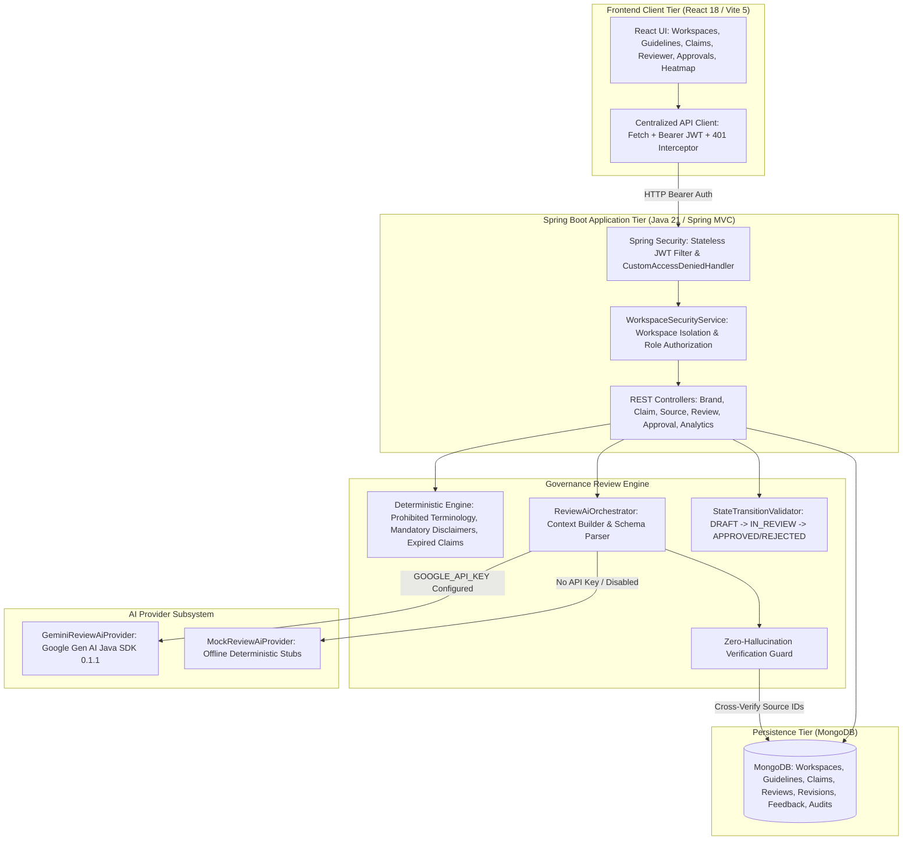
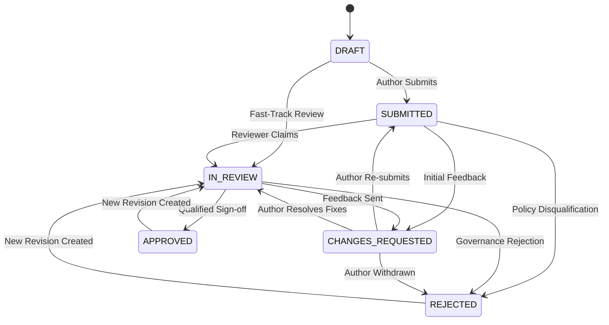

# Inkloom AI — System Architecture & Technical Design

## 1. Executive Summary

Inkloom AI is an enterprise-grade brand governance platform designed to ensure brand consistency, factual veracity, legal disclosure compliance, and tone alignment across all organizational content.

The system is implemented as a decoupled full-stack architecture:
- **Client Tier**: Pure JavaScript React 18 SPA powered by Vite, Tailwind CSS, and Lucide React.
- **Application Tier**: Java 21 Spring Boot 3.3.5 microservice managing authentication, RBAC, domain business services, and AI orchestration.
- **AI Governance Engine**: Official Google Gen AI Java SDK (`com.google.genai:google-genai:0.1.1`) executing against Gemini Developer API (`gemini-2.5-flash`).
- **Data Tier**: MongoDB (Atlas or local instance) persisting 12 isolated collections with indexing and referential integrity.

---

## 2. Architectural Blueprint



---

## 3. The 10-Step Review Pipeline

When an author submits draft copy to `POST /api/v1/reviews`, the backend executes the following immutable 10-step review sequence:

```mermaid
sequenceDiagram
    autonumber
    actor Author as Content Author
    participant API as ReviewController
    participant Guard as WorkspaceSecurity
    participant Svc as ReviewService
    participant DB as MongoDB
    participant AI as GeminiReviewAiProvider

    Author->>API: POST /api/v1/reviews (title, contentType, content)
    API->>Guard: Step 1: Validate JWT & Workspace Access
    Guard-->>API: Authorized
    API->>Svc: Step 2: Validate boundary limits (<= 50k chars)
    Svc->>DB: Step 3: Fetch active Guidelines, Sources & Claims
    DB-->>Svc: Guideline v1.0, Sources (src-1, src-2), Claims Ledger
    Svc->>Svc: Step 4: Run Deterministic Checks (regex prohibited terms, disclaimers, expired claims)
    alt AI Enabled & GOOGLE_API_KEY Present
        Svc->>AI: Step 5: Send content + grounding context to Gemini SDK
        AI-->>Svc: Step 6: Return structured JSON findings
        Svc->>Svc: Step 7: Zero-Hallucination Guard (strip unverified source IDs)
        Svc->>Svc: Step 8: Classify evidence & confidence (<70% -> UNCERTAIN)
    else Offline or AI Disabled
        Svc->>Svc: Skip AI; retain deterministic findings
    end
    Svc->>DB: Step 9: Save Review document, compute score, create Revision #1
    Svc->>DB: Record AuditEvent (REVIEW_SUBMITTED)
    Svc-->>API: Return ReviewResponse DTO
    API-->>Author: Step 10: Typed JSON with Evidence Cards and Intent Lock suggestions
```

---

## 4. Security Boundaries & Zero-Trust Principles

### 1. Client-Side Decoupling
- **No Client AI Calls**: React never contacts Google Gemini or any external AI provider directly.
- **No Bundled Keys**: Frontend bundles contain zero API keys, secrets, or database URLs. All sensitive calls are proxied through authenticated Spring MVC endpoints.

### 2. Workspace Isolation & RBAC
- Every protected entity (`Review`, `BrandGuideline`, `ApprovedSource`, `ApprovedClaim`) carries a `brandId`.
- [`WorkspaceSecurityService.java`](file:///c:/Users/panka/OneDrive/Desktop/inkloom-ai/backend/src/main/java/com/inkloom/security/WorkspaceSecurityService.java) enforces that the calling `UserPrincipal` is an authorized member of the target workspace. Cross-workspace data leakage is blocked at the filter level with `403 Forbidden`.

### 3. Server-Side Zero-Hallucination Source Verification
- Generative AI models are prone to hallucinating plausible-sounding citations.
- Inkloom AI strictly distrusts citations returned in AI outputs:
  - If Gemini outputs `referencedSourceIds: ["src-fake-123"]`, the server cross-references this against the authorized `ApprovedSource` records stored in MongoDB.
  - If the ID does not exist in the database for that workspace, it is stripped immediately, and the finding is downgraded to `UNSUPPORTED_CLAIM` with supporting document text: `"Evidence Not Found in Registered Sources"`.

---

## 5. Intent Lock™ Surgical Correction Model

Traditional generative rewrites often distort the author's voice, delete important marketing context, or dilute calls-to-action.

Inkloom AI enforces **Intent Lock**:
1. **Three Calibrated Strengths**:
   - **Light**: Replaces strictly the prohibited expression with a compliant alternative.
   - **Balanced**: Rephrases the sentence for natural flow and tone compliance.
   - **Strong**: Comprehensive authoritative corporate positioning with necessary qualifiers.
2. **Intent Preservation Rationale**: Gemini is prompted to provide an explicit explanation of *why* the suggestion preserves the author's original message.
3. **Non-Destructive Revisions**:
   - The original submitted draft (`originalContent`) is never modified.
   - When a user accepts a correction, surgical text replacement is applied to `currentContent`.
   - The change increments `activeRevisionNumber` and creates a new sequential [`Revision`](file:///c:/Users/panka/OneDrive/Desktop/inkloom-ai/backend/src/main/java/com/inkloom/model/Revision.java) recording the parent revision (`sourceRevisionNumber`), author, and timestamp.

---

## 6. Human Approval State Machine

Inkloom AI enforces a strict human gatekeeping model. Automated evaluations alone cannot publish or approve content.



- Enforced by [`StateTransitionValidator.java`](file:///c:/Users/panka/OneDrive/Desktop/inkloom-ai/backend/src/main/java/com/inkloom/validator/StateTransitionValidator.java).
- Calling an invalid transition throws `InvalidStateTransitionException` returning `400 Bad Request`.
- Only `ROLE_REVIEWER`, `ROLE_BRAND_MANAGER`, or `ROLE_ADMIN` can record approval or rejection decisions.

---

## 7. Zero-Fabrication Clarity Analytics

Unlike traditional dashboards that show hardcoded mock numbers, the Inkloom Clarity Heatmap calculates signals dynamically from MongoDB:
- **Occurrences**: Count of flags per category across historical workspace reviews.
- **Repeated Phrases**: Most frequently flagged expressions extracted from persisted finding excerpts.
- **Author Acceptance Rate**: $\frac{\text{Accepted Feedback Count}}{\text{Accepted Feedback} + \text{Rejected Feedback}} \times 100\%$.
- **Guideline Conflict Signal**: When author overrides exceed 30%, the engine flags the category as `NEEDS_ATTENTION`, signaling potential ambiguity in the brand guideline.
- **Source Gap Signal**: When claims repeatedly fail verification, the engine flags `SOURCE_GAP`, alerting brand managers to add missing benchmark whitepapers.
- **Honest Empty State**: If a brand workspace has 0 reviews or 0 findings, the system displays an honest `EmptyState` component rather than fabricated metrics.

---

## 8. Data Tier Schema & Collection Specifications

| Collection Name | Document Entity | Primary Purpose | Key Indexes |
|:---|:---|:---|:---|
| `users` | `User` | User identities, hashed passwords, roles | `email` (unique) |
| `brand_workspaces` | `BrandWorkspace` | Tenant boundary, company details, member IDs | `slug` (unique) |
| `brand_guidelines` | `BrandGuideline` | Tone rules, prohibited terms, required disclaimers | `brandId`, `status` |
| `approved_sources` | `ApprovedSource` | Authoritative PDFs, whitepapers, benchmark URLs | `brandId` |
| `approved_claims` | `ApprovedClaim` | Organization ledger of verified factual claims | `brandId` |
| `reviews` | `Review` | Content draft submissions, findings, scores, status | `brandId`, `createdAt` |
| `revisions` | `Revision` | Immutable version snapshots and parent lineage | `reviewId`, `revisionNumber` |
| `review_comments` | `ReviewComment` | Reviewer discussion threads | `reviewId`, `createdAt` |
| `review_decisions` | `ReviewDecision` | Official sign-off decisions and revision identifiers | `reviewId`, `timestamp` |
| `review_feedback` | `ReviewFeedback` | Accepted/rejected Intent Lock suggestions | `brandId`, `category` |
| `audit_events` | `AuditEvent` | Immutable security and governance audit trail | `brandId`, `timestamp` |
